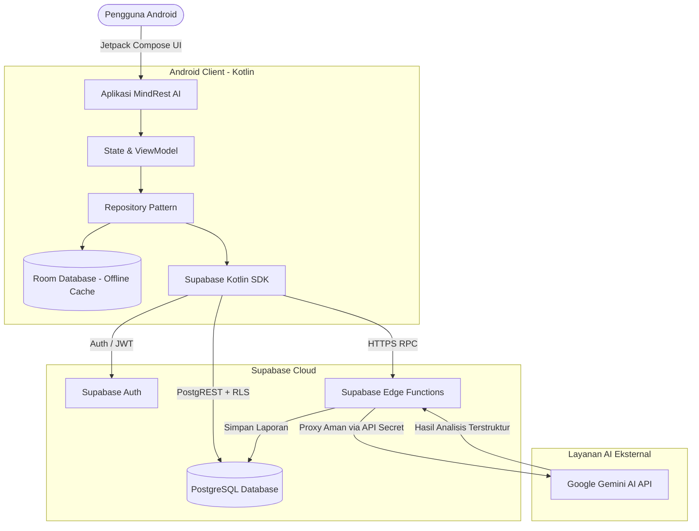

# MindRest AI 🌙✨
### *Ikigai-Driven Sleep Therapy AI Assistant*

[](https://kotlinlang.org)
[-green.svg?style=flat&logo=android)](https://developer.android.com)
[](https://developer.android.com/jetpack/compose)
[](https://supabase.com)
[](https://deepmind.google/technologies/gemini/)
[](LICENSE)

---

## 📌 Tentang MindRest AI

**MindRest AI** adalah aplikasi *mobile* Android berbasis kecerdasan buatan (*Artificial Intelligence*) yang mengintegrasikan terapi tidur berbasis **Cognitive Behavioral Therapy for Insomnia (CBT-I)** dengan filosofi hidup **Ikigai**. 

Aplikasi ini dirancang khusus untuk membantu mahasiswa dan profesional muda mengatasi gangguan tidur, *overthinking*, dan stres akibat beban akademis maupun pekerjaan. Melalui pendekatan holistik, MindRest AI tidak hanya mencatat pola tidur dan suasana hati, tetapi juga membimbing pengguna menemukan keseimbangan rutinitas, motivasi hidup, dan ketenangan pikiran secara berkelanjutan.

---

## ✨ Fitur Utama

| Modul Fitur | Deskripsi |
|---|---|
| 🔐 **Authentication & Profile** | Pendaftaran dan masuk melalui Email (Supabase Auth) dan Google Sign-In (Credential Manager), didukung profil personalisasi gaya hidup dan kesehatan. |
| 🛏️ **Sleep Tracking & Analytics** | Pencatatan otomatis waktu tidur, waktu bangun, dan kualitas tidur harian dengan kalkulasi durasi serta grafik riwayat mingguan. |
| 🎭 **Mood Tracking** | Pemantauan suasana hati harian berbasis emoji (skala 1–5) untuk memetakan dinamika emosional dari waktu ke waktu. |
| 💬 **AI Journal (CBT Chatbot)** | Jurnal harian interaktif berbasis percakapan dengan AI empatik bertenaga Google Gemini untuk meredakan overthinking dan merefleksikan pikiran. |
| 🌸 **Ikigai Assessment & AI Report** | Kuesioner enam aspek Ikigai yang diproses AI bersama riwayat tidur dan jurnal pengguna untuk menghasilkan visualisasi 4 lingkaran Ikigai serta rekomendasi pengembangan diri konkret. |
| 💡 **Sleep Insight** | Rekomendasi pintar mengenai asupan makanan, minuman, dan aktivitas sebelum tidur yang disesuaikan dengan tren tidur pengguna. |
| 🧘 **Relaxation Audio & Breathing** | Panduan latihan pernapasan terarah dan musik relaksasi yang dapat diputar secara *offline* untuk mempercepat proses menuju tidur nyenyak. |
| ⏰ **Bedtime Reminder & Notification** | Pengingat waktu tidur cerdas dan notifikasi lokal Android agar rutinitas tidur tetap konsisten. |
| 📊 **Unified Dashboard** | Beranda terpadu yang merangkum tren tidur 7 hari, grafik mood, insight terbaru, riwayat jurnal, dan daftar kebiasaan harian. |

---

## 🏛️ Arsitektur Sistem

MindRest AI mengusung arsitektur **Klien–Server Modern** yang aman dan modular:



### 🔒 Keamanan & Privasi
- **Row-Level Security (RLS)**: Setiap data (jurnal, log tidur, assessment) dilindungi kebijakan RLS di level PostgreSQL; pengguna hanya dapat mengakses datanya sendiri.
- **Server-Side AI Proxy**: Kunci `GEMINI_API_KEY` dan `SUPABASE_SERVICE_ROLE_KEY` disimpan secara terisolasi di server Supabase Edge Functions dan **tidak pernah terekspos** di sisi klien Android.

---

## 🛠️ Tech Stack & Komponen

### Sisi Klien (Android)
- **Bahasa**: [Kotlin](https://kotlinlang.org/) `2.3.21`
- **UI Framework**: [Jetpack Compose](https://developer.android.com/jetpack/compose) (BOM 2024.09.00) & Material 3
- **Arsitektur**: MVVM (Model-View-ViewModel) + Repository Pattern + Clean Architecture
- **Navigasi**: AndroidX Navigation Compose
- **Database Lokal**: AndroidX Room (offline-first & caching)
- **Komunikasi Asinkron**: Kotlin Coroutines & StateFlow
- **Jaringan & Serialisasi**: Ktor Client, OkHttp, Retrofit, Kotlinx Serialization, Moshi
- **SDK Backend**: Supabase Kotlin SDK (`postgrest-kt`, `auth-kt`, `functions-kt`)

### Sisi Server & Backend
- **Platform**: [Supabase](https://supabase.com/) (PostgreSQL Database, Supabase Auth, Storage)
- **Runtime Edge Functions**: Deno (TypeScript)
- **AI Engine**: Google Gemini API (`gemini-3.5-flash` / Gemini 1.5 Pro)

---

## 📁 Struktur Direktori

```text
mindrest-ai/
├── app/
│   ├── build.gradle.kts           # Konfigurasi dependensi dan build module
│   └── src/main/
│       ├── AndroidManifest.xml    # Manifest aplikasi Android
│       ├── java/com/example/
│       │   ├── core/              # Komponen utilitas, network, design tokens
│       │   ├── data/              # Model data, DAO, Room, dan implementasi repository
│       │   ├── features/          # Modul fitur berbasis Clean Architecture
│       │   │   ├── auth/          # Login, Register, Google Sign-In
│       │   │   ├── home/          # Dashboard utama
│       │   │   ├── ikigai/        # Assessment & visualisasi laporan AI
│       │   │   ├── journal/       # Daily CBT Journal & Chatbot AI
│       │   │   ├── mood/          # Mood tracking
│       │   │   ├── profile/       # Profil pengguna
│       │   │   ├── relaxation/    # Audio & latihan pernapasan
│       │   │   ├── reminder/      # Bedtime alarm & broadcast receivers
│       │   │   └── sleep/         # Sleep tracking & insight
│       │   └── ui/                # Tema warna, tipografi, dan komponen global
│       └── res/                   # Sumber daya drawable, icon, mipmap, XML
├── scripts/                       # Skrip automasi & audit
├── supabase/
│   ├── functions/                 # Supabase Edge Functions (AI Prompt & Proxy)
│   ├── migrations/                # Skrip migrasi database
│   ├── schema.sql                 # Definisi skema tabel & RLS PostgreSQL
│   └── README.md                  # Panduan deployment backend Supabase
├── .env.example                   # Template konfigurasi environment
├── Dokumen Teknis.md              # Dokumentasi teknis lengkap aplikasi
├── run-app.bat                    # Script automasi build & jalankan di emulator
└── README.md                      # Dokumentasi utama proyek
```

---

## 🚀 Panduan Memulai (Quick Start)

### 1. Prasyarat Sistem
- **Java Development Kit (JDK)**: Java 11 atau lebih baru
- **Android Studio**: Ladybug / Koala atau versi terbaru
- **Android SDK**: `minSdk = 26` (Android 8.0 Oreo), `targetSdk = 36`
- **Git**

### 2. Kloning Repositori
```bash
git clone https://github.com/ar-elfahmi/MindRest_AI.git
cd MindRest_AI
```

### 3. Konfigurasi Environment (`.env`)
Salin berkas template `.env.example` menjadi `.env` di root proyek:
```bash
cp .env.example .env
```
Buka berkas `.env` dan lengkapi kredensial:
```properties
# Supabase
SUPABASE_URL=https://YOUR_PROJECT_REF.supabase.co
SUPABASE_ANON_KEY=your_supabase_anon_key_here

# Google Gemini AI (untuk konfigurasi Edge Function / local dev)
GEMINI_API_KEY=your_gemini_api_key_here

# Google Sign-In (Web OAuth Client ID dari Google Cloud Console)
GOOGLE_WEB_CLIENT_ID=your_oauth_client_id.apps.googleusercontent.com
```

### 4. Build dan Jalankan Aplikasi

#### Menggunakan Android Studio:
1. Buka Android Studio → *File* → *Open* → Pilih folder repositori ini.
2. Sinkronkan Gradle (*Sync Project with Gradle Files*).
3. Pilih perangkat emulator atau fisik (Android 8.0+).
4. Klik tombol **Run** (`Shift + F10`).

#### Menggunakan Terminal / Command Line:
- **Windows**:
  ```cmd
  gradlew.bat assembleDebug
  ```
- **Linux / macOS**:
  ```bash
  ./gradlew assembleDebug
  ```

> 💡 **Tips Pengguna Windows**: Anda juga dapat langsung menjalankan file `run-app.bat` untuk melakukan compile otomatis, menyalakan emulator Pixel, menginstal APK, dan membuka aplikasi secara instan.

---

## ⚙️ Pengaturan Backend Supabase

Jika Anda ingin menjalankan backend mandiri:
1. Buat proyek baru di [Supabase Dashboard](https://supabase.com/).
2. Masuk ke menu **SQL Editor**, salin dan jalankan isi dari berkas [`supabase/schema.sql`](supabase/schema.sql) serta migrasi di [`supabase/migrations/`](supabase/migrations/).
3. Deploy Edge Function untuk modul AI Ikigai:
   ```bash
   supabase functions deploy generate-ikigai-report
   supabase secrets set GEMINI_API_KEY=<kunci_api_gemini>
   supabase secrets set SUPABASE_SERVICE_ROLE_KEY=<kunci_service_role>
   ```
4. Panduan backend lengkap tersedia di [supabase/README.md](supabase/README.md).

---

## 👥 Tim Pengembang (Coup Dès)

Aplikasi ini dikembangkan oleh **Tim Coup Dès** — **Universitas Airlangga**:

- **Alfian Rasyid El Fahmi** ([@ar-elfahmi](https://github.com/ar-elfahmi))
- **Muhammad Faris Sabiq**
- **Rozan Aiman Ramadani** ([@RozanRamadani](https://github.com/RozanRamadani))

**Dosen Pembimbing:** Dr. Indra Kharisma Raharjana, S.Kom., M.T.

---

## 📄 Lisensi

Proyek ini dilisensikan di bawah [Apache License 2.0](LICENSE).
Komponen pustaka pihak ketiga tunduk pada lisensi terbuka masing-masing pengembang.
